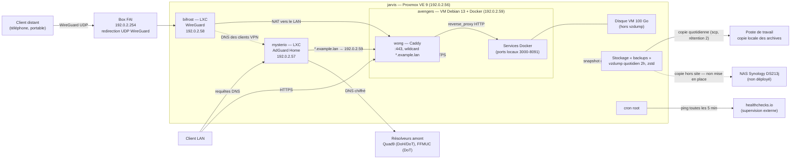

# Homelab

Infrastructure auto-hébergée sur un seul hôte Proxmox, que j'utilise au quotidien (fichiers, agenda, mots de passe, supervision). Elle me sert aussi de terrain d'apprentissage pour l'administration système, le réseau et la sécurité.

Les configurations publiées ici sont des copies assainies. Le domaine est remplacé par `example.lan`, les adresses par les plages de documentation (`192.0.2.0/24` pour le LAN, `198.51.100.0/24` pour le VPN), et les secrets par `CHANGE_ME`.

## Architecture

Un client distant entre par WireGuard. Le seul port redirigé par la box est celui de WireGuard, en UDP. Le 443 n'est pas ouvert : Caddy n'écoute que sur le LAN, et aucun service n'est joignable depuis Internet. Une fois connecté, il résout les noms via AdGuard comme un poste du LAN. Tous les noms `*.example.lan` pointent vers Caddy, qui termine TLS avec un certificat wildcard obtenu par challenge DNS-01. Aucun service n'a donc besoin d'être joignable depuis Internet pour avoir un certificat valide.

## Services

La convention de nommage vient de l'univers Marvel : les lieux pour l'infrastructure, les personnages pour les services applicatifs.

| Nom | Rôle | Exposition |
|---|---|---|
| jarvis | Hyperviseur Proxmox VE | Interne / via VPN |
| mysterio | AdGuard Home, DNS filtrant et réécritures locales | Interne / via VPN |
| bifrost | Serveur WireGuard | Publique (UDP, seul port redirigé) |
| avengers | VM Docker, gérée avec Dockge | Interne / via VPN |
| wong | Caddy, reverse proxy et TLS wildcard | Interne / via VPN |
| edith | Homepage, tableau de bord | Interne / via VPN |
| heimdall | Uptime Kuma, supervision interne | Interne / via VPN |
| tva | ntfy, notifications push | Interne / via VPN |
| uatu | Diun, alertes de mises à jour d'images | Interne (pas d'interface) |
| wakanda | Vaultwarden, gestionnaire de mots de passe | Interne / via VPN |
| sanctum | Nextcloud, fichiers, agenda et tâches | Interne / via VPN |
| oracle | Docmost, documentation | Interne / via VPN |
| karen | FreshRSS, veille | Interne / via VPN |
| loki | Stirling PDF | Interne / via VPN |
| strange | CyberChef | Interne / via VPN |
| shuri | IT-Tools | Interne / via VPN |
| shawarma | Tandoor, recettes | Interne / via VPN |
| stan | Komga, bibliothèque de comics | Interne / via VPN |
| yondu | Suwayomi, récupération de mangas | Interne / via VPN |

Le script [`avengers/scripts/newservice.sh`](avengers/scripts/newservice.sh) ajoute ou retire un service en une commande. Il met à jour le Caddyfile, qu'il valide avant de redémarrer Caddy, puis la réécriture DNS AdGuard et l'entrée Homepage.

## Choix techniques

**WireGuard nu plutôt que Tailscale.** Tailscale aurait évité la redirection de port et la gestion des clés. Je l'ai écarté pour ne pas dépendre d'un serveur de coordination tiers et pour maîtriser moi-même le protocole : génération des clés et des PSK, allocation des adresses, choix entre split tunnel et full tunnel, NAT avec iptables. Le coût : une IPv4 publique non-CGNAT est indispensable, et l'ajout d'un client passe par un script de provisionnement.

**Caddy plutôt que Nginx Proxy Manager.** NPM stocke sa configuration dans une base et se pilote par une interface web : l'état réel n'est pas lisible dans un dépôt Git, et un changement ne se relit pas. Le Caddyfile versionnable en texte, un seul bloc wildcard, et le module DNS OVH compilé avec `xcaddy` (voir le [Dockerfile](avengers/stacks/wong/Dockerfile)) pour le challenge DNS-01. Le script `newservice.sh` valide le Caddyfile avant de recharger : une erreur de syntaxe ne coupe pas le reverse proxy.

**Proxmox plutôt que Docker directement sur l'hôte.** Séparer les fonctions qui doivent survivre à une panne des autres. Le DNS et le VPN tournent dans des LXC séparés de la VM Docker. Un incident ou une mise à jour côté Docker ne coupe donc ni la résolution ni l'accès distant. L'ordre de démarrage est explicite (mysterio, puis bifrost, puis avengers), et vzdump sauvegarde chaque invité par snapshot, ce qui permet de restaurer une machine entière plutôt qu'un jeu de conteneurs.

**Sauvegarde 3-2-1 — partiellement en place.** Je préfère décrire l'état réel plutôt que la cible :

- un vzdump quotidien à 2 h de tous les invités, en mode snapshot, compressé en zstd, avec les deux dernières sauvegardes conservées, vers le stockage `backups` (`/mnt/backups`) ;
- `/mnt/backups` est un volume **du même disque que l'hyperviseur** : ce n'est donc pas une seconde copie au sens 3-2-1, seulement une protection contre l'erreur humaine ;
- un script côté poste de travail récupère les archives à chaque ouverture de session et en conserve deux : c'est la seule copie sur un support distinct ;
- **la copie hors site n'existe pas.** C'est le manque assumé de cette installation. Le NAS prévu pour la porter n'est pas déployé ;
- le disque de 100 Go exclu de vzdump ne contient que des données re-téléchargeables, et n'est volontairement pas sauvegardé.

Rétention minimum de deux archives et jamais une seule : une sauvegarde interrompue écraserait l'unique copie.

## Ce que j'en ai tiré

- **Incident : le tunnel montait, mais rien ne passait.** Après un redémarrage, le handshake WireGuard réussissait et le trafic restait asymétrique — quelques centaines de kilooctets reçus, presque rien émis. Cause : `net.ipv4.ip_forward` était retombé à 0. Dans un LXC non privilégié, le `sysctl` au démarrage peut échouer en silence, puisque le noyau appartient à l'hôte. Le réglage tenait en mémoire depuis l'installation et n'avait jamais été retesté. Correction : l'activer dans le `PostUp` de `wg0.conf`, donc à chaque montée du tunnel. Leçon retenue : un service qui fonctionne n'est pas un service qui survit à un redémarrage — depuis, je redémarre volontairement après chaque configuration.
- **Superviser depuis l'extérieur.** Uptime Kuma tourne sur la machine qu'il surveille : si l'hôte tombe, il n'alerte personne. Un cron sur l'hyperviseur envoie donc un ping à healthchecks.io toutes les cinq minutes, et seulement si Uptime Kuma et ntfy répondent. C'est l'absence de ping qui déclenche l'alerte.
- **Le DNS est le point de défaillance commun.** Chaque profil WireGuard existe en version « secours » avec un résolveur public, pour garder l'accès quand le LXC AdGuard est arrêté.
- **La documentation dérive de la réalité.** En préparant ce dépôt, j'ai découvert que le durcissement SSH de l'hyperviseur était noté comme appliqué dans mes notes alors que le fichier n'existait pas : la connexion root par mot de passe était restée ouverte sur le LAN. Depuis, je vérifie l'état réel avant de documenter, et l'audit qui a produit ce dépôt est devenu un contrôle à part entière.
